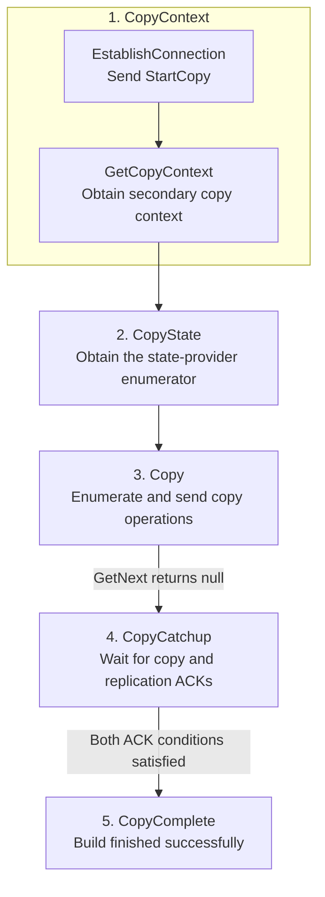
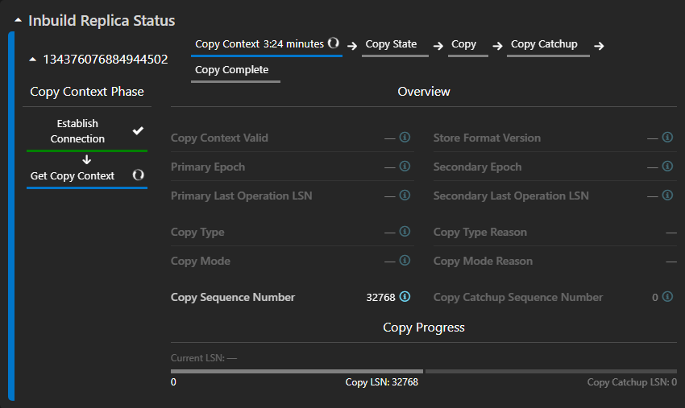
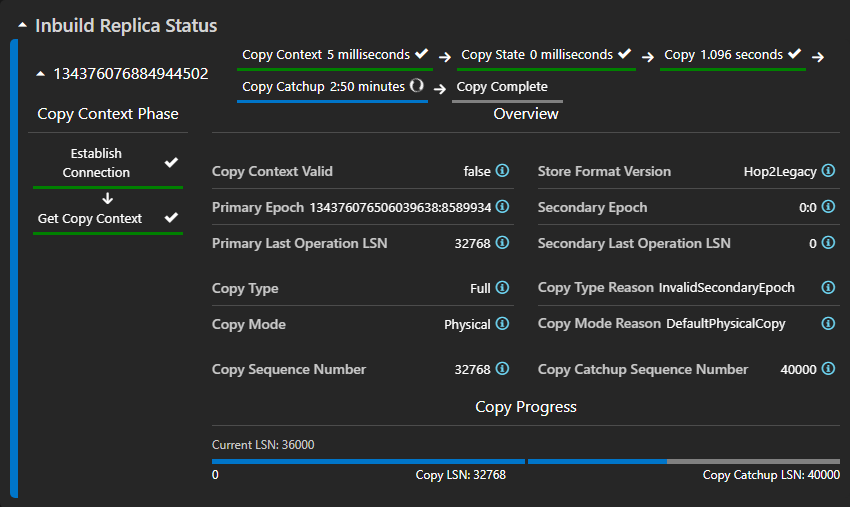
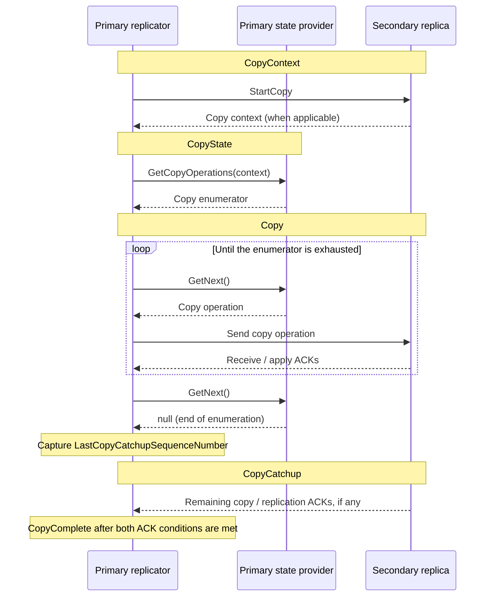
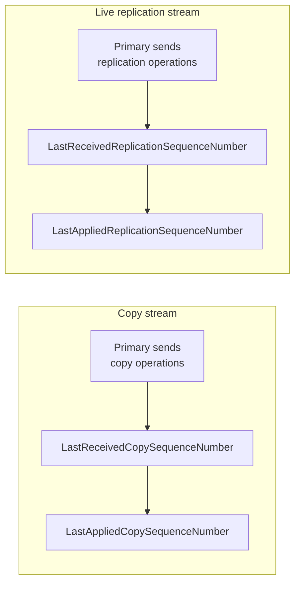
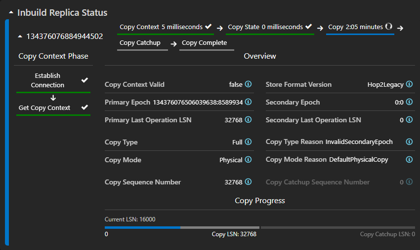

# Understanding Inbuild Replica Status

When a new secondary/idle replica is added to a stateful service partition, the primary
replica has to bring it "up to date" before it can vote or (in the case of a secondary)
serve reads. This process is called **building** the replica, and while it's in progress
the primary reports live progress for it under `RemoteReplicatorStatus.RemoteReplicators[].
RemoteInbuildReplicaStatus` (returned by the `GetReplicaDetail` REST API, and surfaced in
Service Fabric Explorer as the **"Inbuild Replica Status"** panel on the partition page).

Use this guide to locate what a slow or stuck build is waiting for, distinguish
primary-side work from secondary-side work, and choose an evidence-based mitigation.
The phase and field descriptions support that investigation; a phase name by itself
does not identify the faulty node.

## When to use this guide

- A replica has been "Building" for an unusually long time.
- You need to tell whether a build is making progress or is stuck, and in which phase.
- You want to get more details about how exactly the replica is being built.
- You want to understand what a specific field (e.g. `CopyTypeReason`, `LastCopySequenceNumber`)
  actually means before escalating.

## Start here -- identify the stuck inbuild replica

1. **Find the building replicas.** On the partition page, expand **Inbuild Replica
   Status**. Each replica has its own pane, labeled with its Replica ID.
2. **Identify the phase taking time.** Use the **horizontal phase stepper** in each
   replica's header and the time shown beside each phase to identify its current phase
   and where the build is spending time.
3. **Expand the replica pane.** Open the affected replica's pane to see more details
   about its in-progress build.
4. **If the build is in Copy Context, identify the sub-phase.** Use the **vertical
   Copy Context Phase stepper** to see whether it is waiting in **Establish Connection**
   or **Get Copy Context**.

Once you have identified the phase or sub-phase, follow the corresponding checks below.
A long-running phase is a starting point for investigation, not proof that progress
has stopped.

### Quick routing table

| Active phase in SFX | What is the build waiting for? | Start with |
|---|---|---|
| Copy Context / Establish Connection | Sending the request to start copying. | [Connection and secondary availability](#establish-connection). |
| Copy Context / Get Copy Context | Learning what state the secondary already has. | [Secondary context generation and delivery](#get-copy-context). |
| Copy State | Preparing the data stream on the primary. | [The primary's state provider](#phase-2----copy-state). |
| Copy | Sending the state to the secondary. | [Copy received and applied counters](#phase-3----copy). |
| Copy Catchup | Confirming that copy and replication work has been applied. | [Both copy and replication progress](#phase-4----copy-catchup). |
| Copy Complete | The successful build is finished. | [Replica status and partition health](#phase-5----copy-complete). |

### Primary or secondary? Use the evidence, not just the phase

The following are investigation directions, not root-cause verdicts.

| Observation across samples | What it helps distinguish | Next evidence to collect |
|---|---|---|
| Received advances, applied stays flat for the same stream. | The primary is observing receive progress but not apply progress. Investigate secondary application and apply-ACK delivery. | Secondary provider activity, disk latency/free space, CPU, locks, health, and ACK sends/receipt. |
| Received and applied both advance. | That stream is progressing; the issue may be low throughput rather than a complete stall. | Rates over time, state size/copy mode, resource contention, and the other stream during catchup. |
| Received and applied are both flat. | Counters alone cannot distinguish a primary provider wait, blocked send, unreachable secondary, or lost/stale ACKs. | Correlate provider `GetNext`, primary sends, secondary receives/applies, and ACKs returning to the primary. |
| Several builds from one primary slow down together. | A shared primary or network bottleneck is a hypothesis, not proof. | Primary provider/host/storage telemetry and connectivity to each affected secondary. |
| Only one target replica is slow while others progress. | A target-specific provider, host, or network path is a hypothesis. | Compare that secondary's health/resources and its connection with a progressing target. |

**Mitigation guardrails:** restore a confirmed connectivity problem, address demonstrated
disk/capacity or CPU contention, or reduce competing workload when operationally
appropriate. Escalate a blocked provider call with its traces and stacks. Do not select
failover, replica removal, data deletion, or simultaneous replica restarts solely from
this panel; disruptive recovery requires checking quorum, data safety, and the applicable
service recovery procedure first. A full copy or a dimmed progress bar is not, by itself,
an error requiring recovery.

## Understand the phase where the build is waiting

Match the active label in the horizontal stepper to the section below. For **Copy
Context**, also match the active label in the vertical stepper.

A successful replica build follows these five phases in order. The diagram shows one
build attempt, not failure, cancellation, or a later retry.

`CopyContext` additionally has two sub-phases (`CopyContextPhase`): `EstablishConnection`,
then `GetCopyContext`.

**Key distinction:** `Copy` ending means the provider has finished **enumerating** copy
operations. It does not mean the secondary has finished applying them. Outstanding copy
ACKs can still hold the build in `CopyCatchup`.

### Phase 1 -- Copy Context

**What it means:** the primary is setting up the copy and learning what state the
secondary already has. This information is called **copy context**. It helps the
primary decide what to send; it is not the data being copied.

Expand the replica pane and look at the **vertical Copy Context Phase stepper**.
The active sub-phase tells you which checks to follow.

#### Establish Connection

**What it means:** the primary is trying to send the secondary a request to start the
copy (`StartCopy`).

**What to check:**

- Is the secondary's node up, and is the target replica available?
- Are there connection or send errors on the primary?
- Do the secondary's traces show that it received the request?

**Which side to investigate:** if the request has not reached the secondary, check
the connection between the nodes and the target's availability. If it has arrived,
check how the secondary is processing it. The phase alone does not identify a faulty
node.

**What to do next:** fix the connection or availability problem you have confirmed,
then check whether the vertical stepper moves to **Get Copy Context**. That transition
follows a successful send callback on the primary; it does not, by itself, prove that
the secondary has acknowledged the request. Copy LSN counters do not measure progress
in this sub-phase.

#### Get Copy Context

**What it means:** the secondary provides information about its existing state, and
the primary uses that information to prepare the copy.

**What to check:**

- Is the secondary's state provider returning its copy context?
- Is that context reaching the primary?
- Is the primary's state provider able to read it?

**Which side to investigate:** start with the secondary if it is not producing the
context. If it is producing context, follow the transfer to the primary and check
whether the primary is waiting while reading it. Context is streamed, so producing,
transferring, and reading it can overlap.

**What to do next:** address the provider, resource, or connection problem that the
checks reveal. If a provider call is blocked without a clear cause, collect its traces
and thread stacks before choosing recovery. Once the horizontal stepper moves to
**Copy State**, follow that phase's checks instead of continuing to investigate the
initial connection.

*Illustrative playback:* **Get Copy Context** is active; **Establish Connection** is
completed. The dimmed provider fields and inactive `Current LSN` are expected at this
point, not evidence that the store is unhealthy. Follow context generation, delivery,
and consumption rather than waiting for the copy-progress bar to fill.

### Phase 2 -- Copy State

**What it means:** the primary's state provider is preparing the stream of data to send
to the secondary. It does this through `GetCopyOperations`. Copy operations are not yet
being read from that stream, so a lack of copy LSN progress is expected here.

**What to check:** start on the primary. Check state-provider health and errors,
storage latency, CPU pressure, and calls waiting on locks or other work. If the provider
is waiting to read the secondary's copy context, follow the **Get Copy Context** checks
as well.

**Which side to investigate:** this preparation runs on the primary, but it can depend
on context from the secondary. Identify what the primary's call is waiting for before
assigning the problem to either node.

**What to do next:** address the resource or context-delivery problem you have found.
If the provider call remains blocked, collect its traces and thread stacks for
escalation. Restarting the secondary is not a general fix for a wait on the primary.
When the stream is ready, the horizontal stepper moves to **Copy**.

### Phase 3 -- Copy

**What it means:** the primary is reading data from its state provider and sending it
to the secondary. The secondary receives and applies that data.

**How the copy is chosen:** at the start of this phase, the ESE-backed KVS provider
reads the secondary's copy context and compares it with the primary's own state,
including their epochs and operation sequence numbers. This determines the **Copy
Type**:

- **Partial copy:** the secondary's existing state can be used, so the primary sends
  the changes needed to bring it up to date.
- **Full copy:** the secondary's existing state cannot be used as the starting point,
  so the primary sends a full copy of the state.

The provider also chooses the **Copy Mode**: **Logical** sends records, while
**Physical** transfers database files. This choice also considers store-format
compatibility, whether the secondary supports physical copy, and copy configuration.
For ESE-backed KVS, physical copy is a full-copy option; partial copies use logical
copy. A full copy can be either logical or physical.

These decisions and the setup for the selected copy happen as the provider begins
reading the copy stream. A replica can therefore be in **Copy** before data transfer
starts advancing the progress counters.

**What to check:** expand the replica pane. For ESE-backed KVS, look at **Copy Type**,
**Copy Type Reason**, **Copy Mode**, and **Copy Mode Reason** in **Overview** to see
what was selected and why.

Then look at **Copy Progress**. During this phase, **Current LSN** shows the
applied-copy cursor. Compare it across refreshes, then compare
`LastReceivedCopySequenceNumber` with `LastAppliedCopySequenceNumber` in the replicator
details.

- **Received and applied are advancing:** the copy is progressing. A large copy may
  take time; compare its rate with similar builds before treating it as stuck.
- **Received advances but applied does not:** investigate secondary processing and
  whether its apply acknowledgements are returning to the primary. Check the
  secondary's storage, CPU, and provider health.
- **Neither advances:** check whether the primary's provider is producing data,
  whether the primary is sending it, and whether it reaches the secondary. Flat
  counters alone cannot tell you which side is blocked.

**Which side to investigate:** follow the data from primary preparation and sending
to secondary receipt and application. A slow secondary can also make the primary wait
through flow control. The displayed counters reflect acknowledgements processed by
the primary, so confirm the suspected wait with traces from both sides.

**What to do next:** address the bottleneck you find. Use the copy type, mode, and
reasons to understand the work involved; a full copy is not, by itself, a fault.
Reduce competing work when appropriate rather than repeatedly restarting a large
copy that is still progressing. The ESE copy-detail fields are not available for
Reliable Collections or TStore-backed KVS; their absence is not a fault.

The stepper moves to **Copy Catchup** when the primary has finished reading the copy
stream (`GetNext()` returns null). This does **not** mean the secondary has finished
applying everything it received.

### Phase 4 -- Copy Catchup

**What it means:** the primary has finished reading the copy stream. It is now waiting
for the secondary to acknowledge the remaining work: both the last copy operation
and the required replication operations.

**What to check:** expand the replica pane and compare **Current LSN** with **Copy
Catchup LSN**. In this phase, **Current LSN** is the applied-replication cursor, not the
applied-copy cursor.

1. **If Current LSN is below Copy Catchup LSN**, compare the replication received and
   applied counters. Received advancing without applied progress directs you to
   secondary processing and its apply acknowledgements. If both are flat, trace
   sending, delivery, and acknowledgements on both sides.
2. **Also check the last-copy acknowledgement.** Copy Catchup can still be waiting
   for copy data to be applied; it is not only a replication wait.
3. **If Current LSN has reached the displayed target but the phase has not changed**,
   collect copy-completion and replication acknowledgement traces from both nodes.
   The progress bar does not show every remaining completion condition.

**Which side to investigate:** use the received/applied counters and traces to
distinguish secondary processing from a delivery or acknowledgement problem. Do not
assign the fault to the secondary just because this phase waits for its acknowledgements.

**What to do next:** address confirmed secondary resource pressure, reduce competing
work when appropriate, or repair the affected delivery path. Then check for counter
progress and completion. Later primary writes do not continuously move the displayed
catchup target, although the workload can compete for resources. A full progress bar
alone is not a reason to restart a replica.

*Illustrative playback:* **Copy Catchup** is active. `Current LSN: 36000` is below
`Copy Catchup LSN: 40000`, so compare replication receive and apply counters next to
locate the outstanding work. The filled copy half is only a display indicator; verify
the last-copy ACK condition independently before concluding that only replication
remains.

### Phase 5 -- Copy Complete

**What it means:** on a successful attempt, the build is finished. SFX removes replicas
reporting `CopyComplete` from **Inbuild Replica Status**, even if `IsInBuild` has not
yet changed to false.

**What to check:** refresh the partition page and check the replica's role, status,
and health, along with partition health.

**What to do next:** if the replica is still not ready or another build starts, check
build completion/failure and reconfiguration events. That is a separate investigation
from a build waiting in one of the earlier phases. Disappearing from this panel does
not, by itself, prove that the partition has recovered.

### Reference -- who does what during a build?

The primary drives the build, its state provider supplies the copy stream, and the
secondary receives and acknowledges operations. This is a simplified successful-build
sequence; retries and individual copy-context messages are omitted.

Live replication also runs during the build; the diagram omits those individual sends
for readability. ACKs need not arrive in lockstep with each `GetNext()` call, and some
or all required ACKs may already have arrived when enumeration ends.

## Field reference

### LSN fields -- what "received" vs "applied" means

Two different pairs of LSN counters are reported, one for each of the two data streams a
building replica receives concurrently:

| Field | Stream | Meaning |
|---|---|---|
| `LastReceivedCopySequenceNumber` | Copy | Highest copy-operation LSN the secondary has **received** so far. |
| `LastAppliedCopySequenceNumber` | Copy | Highest copy-operation LSN the secondary has **applied** (persisted/committed) so far. This is the live cursor for `Copy`-phase progress. |
| `LastReceivedReplicationSequenceNumber` | Replication | Highest live-replication LSN **received** while building. |
| `LastAppliedReplicationSequenceNumber` | Replication | Highest live-replication LSN **applied**. This is the live cursor for `CopyCatchup`-phase progress. |

"Received" can lead "applied" -- a gap between them means the secondary has data queued
up but hasn't finished processing/persisting it yet (worth checking for disk or CPU pressure
on the secondary if the gap grows).

Read each row independently: the space between its received and applied counters is
work received but not yet acknowledged as applied. The arrows show processing order,
not relative speed or a shared numeric scale between the two streams. Compare repeated
samples of the **same** counter to see whether it is advancing.

### The two frozen targets

| Field | Frozen when | Meaning |
|---|---|---|
| `LastCopySequenceNumber` | `CopyContext` starts (`EstablishConnection`) | The primary's replication LSN at build start. SFX uses this as the reference target for the copy-progress display; the `Copy` phase itself ends when enumeration finishes. |
| `LastCopyCatchupSequenceNumber` | `Copy` ends | The primary's replication LSN at the moment the last copy operation was identified. This is the target `LastAppliedReplicationSequenceNumber` must reach to finish `CopyCatchup`. |

These reported targets are captured at different moments; neither continuously follows
new writes on the primary. Do not confuse the gap to the reported catchup target with the
gap to the primary's latest live LSN.

For example, if `LastCopyCatchupSequenceNumber = 150` and the applied replication LSN
advances from `120` to `140`, the gap to that target shrinks from `30` to `10`, even if the
primary's latest live LSN has meanwhile reached `200`. The last copy operation must also
be ACKed; reaching the replication target alone is not enough.

### CopyDetails / ProviderCopyDetail (ESE-backed Key-Value-Store partitions only)

These fields are only ever populated for KVS partitions backed by the **ESE** provider
(`FABRIC_KEY_VALUE_STORE_PROVIDER_KIND_ESE`). Reliable Collections (non-KVS) partitions, and
KVS partitions backed by **TStore** (`FABRIC_KEY_VALUE_STORE_PROVIDER_KIND_TSTORE`), never
populate this struct -- the equivalent TStore-specific detail isn't implemented server-side.
They appear once the `Copy` phase's first `GetNext()` succeeds.

| Field | Meaning |
|---|---|
| `IsCopyContextValid` | Whether the secondary's copy context (retrieved during `CopyContext`) was valid. |
| `StoreFormatVersion` | On-disk ESE store format the copy uses (`Legacy` / `Hop1` / `Hop2Legacy`). |
| `PrimaryEpoch` / `SecondaryEpoch` | Epoch (`DataLossVersion:ConfigurationVersion`) each side reported at copy negotiation. |
| `PrimaryLastOperationSequenceNumber` / `SecondaryLastOperationSequenceNumber` | Last applied operation LSN each side reported at negotiation. |
| `CopyType` | `Full` or `Partial` -- decided by comparing primary and secondary state. |
| `CopyTypeReason` | Why that copy type was chosen -- see table below. |
| `CopyMode` | `Physical` (raw file copy) or `Logical` (record-by-record copy). |
| `CopyModeReason` | Why that copy mode was chosen -- see table below. |

**CopyTypeReason values:**

| Reason | Meaning |
|---|---|
| `InvalidSecondaryEpoch` | Secondary's reported copy-context epoch is invalid; forces a full copy immediately. |
| `EmptySecondary` | Secondary reports no operations at all -- a fresh/empty secondary; forces a full copy. |
| `FalseProgress` | Secondary's reported LSN/epoch is ahead of what the primary's progress vector recorded -- an impossible history; forces a full copy. |
| `MatchedConfigurationNumber` | Secondary's epoch matches an entry in the primary's progress vector; partial copy starts from the secondary's last committed LSN + 1. |
| `EpochNotFound` | No entry in the primary's progress vector matches the secondary's epoch; forces a full copy. |
| `StaleSecondary` | Secondary matched a configuration number, but its LSN is below the primary's tombstone low-watermark; downgrades to full copy. |
| `PrimaryTombstonesNotTruncated` | Partial copy already matched, but the tombstone-staleness check was skipped because the primary has never truncated tombstones. |

**CopyModeReason values:**

| Reason | Meaning |
|---|---|
| `DefaultPhysicalCopy` | Full copy with data to send, secondary supports file-stream copy, and nothing forced logical -- physical copy is used. |
| `LogicalCopyProbability` | Selected via a random sample against `LogicalCopyProbabilityInPercent`, which periodically exercises the logical path even when physical would qualify. |
| `IncompatibleStoreFormatVersion` | Secondary's on-disk store format isn't compatible with the primary's; forces logical copy. |
| `EmptyDatabase` | Primary has no operations to copy; physical file-stream copy isn't attempted. |
| `FileStreamFullCopyNotSupportedBySecondary` | Secondary doesn't support receiving a file-stream full copy. |
| `FullCopyModeConfiguredAsLogical` | Physical full copy is disabled and the store is explicitly configured as logical. |
| `EnableFileStreamFullCopySetToFalse` | Physical full copy is disabled via the `EnableFileStreamFullCopy` config flag. |

## Reading it in Service Fabric Explorer

On the stateful partition page, expand **Inbuild Replica Status**. The section contains
one collapsible pane per building replica, identified by its **Replica ID**. Replicas
already reporting `CopyComplete` are excluded. The information icon beside the section
title links to this guide.

On wide screens replica panes can sit side by side; on narrower screens they wrap,
and the details within a pane stack. Provider-specific fields are omitted for
Reliable Collections and TStore-backed KVS partitions.

*Illustrative playback:* this is the current local SFX UI displaying an ESE-backed KVS
replica in **Copy**. `Current LSN: 16000` is the applied-copy cursor and `Copy LSN:
32768` is the displayed copy target. The catchup target is not yet available.

All screenshots in this guide were captured from the local SFX UI using edited
playback copies of local test-cluster responses. Phase selection, counters, and elapsed
times illustrate how to read the panel; they are not evidence of an actual stuck build.

### Replica header -- build phases at a glance

The **horizontal phase stepper is in the replica pane's header**, alongside the Replica
ID, so you can read its progress without expanding that pane. The labels are **Copy
Context**, **Copy State**, **Copy**, **Copy Catchup**, and **Copy Complete**. The stepper
wraps when space is limited.

Durations appear alongside the phase names when valid start timestamps are available.
For a completed phase, the duration runs from its start to the next phase's start; for
the current phase, it runs from its start to the current time. **Copy Complete** has no
duration.

### Expanded body -- Copy Context Phase and Overview

- **Copy Context Phase** is a separate vertical sub-stepper to the left of Overview:
  **Establish Connection**, then **Get Copy Context**. After the build moves beyond
  `CopyContext`, both sub-steps are shown as completed. On a narrow pane this column
  moves above Overview.
- **Overview** groups the details in paired fields. For
  ESE-backed KVS partitions, the copy-context and copy-type/mode fields stay in place,
  dimmed with dash placeholders until ESE copy detail is available. For Reliable
  Collections and TStore-backed KVS partitions, those fields are hidden entirely, not
  shown as pending.
- **Copy Sequence Number** and **Copy Catchup Sequence Number** appear below the
  provider-specific details. They correspond to `LastCopySequenceNumber` and
  `LastCopyCatchupSequenceNumber`, respectively.

### Copy Progress -- two equal-width LSN ranges

**Copy Progress** sits inside Overview, below the sequence-number fields. It is not a
separate "LSN Progress" panel.

| Display element | How to read it |
|---|---|
| Left half of the bar | Copy progress, using `LastAppliedCopySequenceNumber` over the range from `0` to `LastCopySequenceNumber`. |
| Right half of the bar | Catchup progress, using `LastAppliedReplicationSequenceNumber` over the range from `LastCopySequenceNumber` to `LastCopyCatchupSequenceNumber`. |
| Labels below the bar | `0` at the start, `Copy LSN: <value>` at the boundary, and `Copy Catchup LSN: <value>` at the end. |
| `Current LSN` above the bar | `LastAppliedCopySequenceNumber` during `Copy`; `LastAppliedReplicationSequenceNumber` during `CopyCatchup`. Outside those phases, the label is dimmed and shows a dash instead of a cursor. |

The two halves have **equal visual width**, regardless of the number of LSNs each
represents. Fill is clamped between 0% and 100% within each half; it is not a percentage
of elapsed build time or bytes transferred.

A half with no valid numeric range (for example, its target is not greater than its
start) is dimmed and has no fill. Its sequence-number field and boundary/target label
are dimmed as well. This is different from a valid range at 0% progress.

Use the phase stepper to identify the active phase, then compare the relevant counters
across refreshes. The progress bar is a visualization, not the build-completion test:
`CopyCatchup` still requires both copy and replication ACK conditions described above.

## If the build is still stuck -- collect an escalation package

Preserve the following before disruptive recovery, when operationally possible:

- Partition ID, service name/provider, runtime version, primary and target Replica IDs,
  node names, and replica/partition health.
- A time series of phase/sub-phase, phase start times, all four LSN counters, the two
  reported targets, and acknowledgement/queue details. Include the sampling interval
  and note any primary change, replica replacement, or build retry.
- ESE copy type, mode, and reasons when available. Do not treat their absence on other
  providers as missing diagnostic data.
- Traces from **both primary and secondary** covering the same build attempt: handshake,
  provider calls, copy/context sends and receipt, replication progress, and ACKs.
  Correlate by partition, replica/session identity, and operation sequence numbers,
  not just timestamps from different machines.
- CPU, memory, disk latency/free space, and network evidence for both nodes; blocked-call
  stacks when a provider call is the suspected wait.
- The mitigation attempted, why that evidence justified it, and before/after progress.

State what remains unknown explicitly: for example, "the primary reports flat receive
and apply counters, but secondary receipt and ACK traces are unavailable." That is a
specific evidence gap, not proof that either node is at fault.
